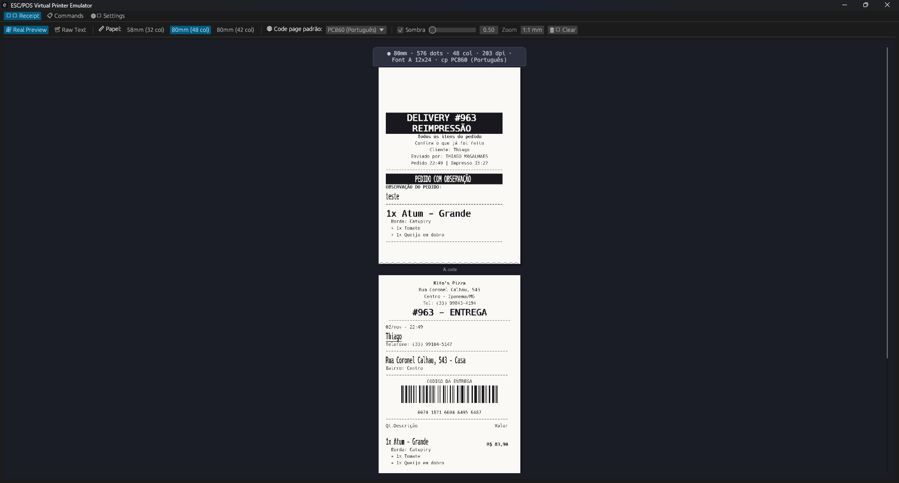
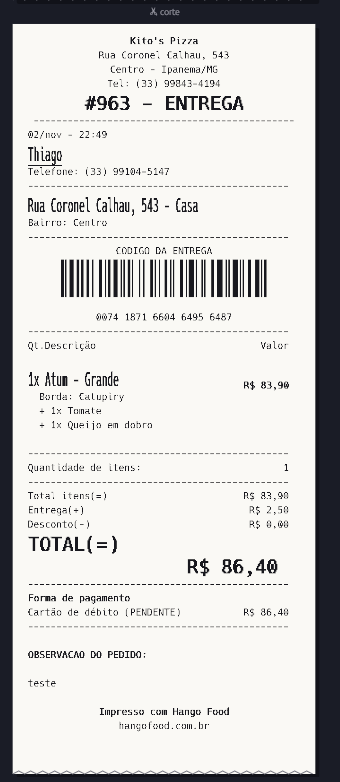
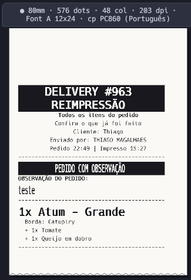
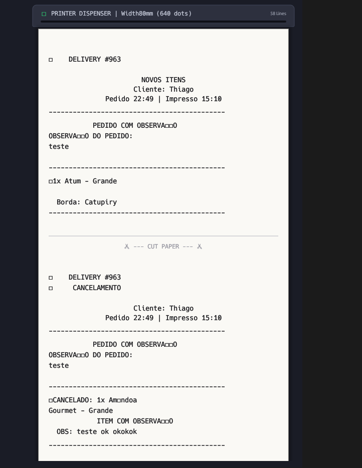

# 🖨️ ESC/POS Thermal Printer Emulator

[](https://www.rust-lang.org/)
[](LICENSE)


🇧🇷 [Português](README.md) | 🇺🇸 **English**

> Turns your computer into a virtual thermal receipt printer.
> It shows **exactly** what would come out on paper: same width, columns, character sizes, accents, line wrapping, QR codes and cuts.

Use it to develop and test POS, delivery, kitchen-ticket and fiscal-receipt software without wasting paper rolls or needing a physical printer.



## ✨ Why it matches the paper

The emulator does not draw "text with a screen font". It works like the printer firmware: every character is burned **dot by dot** into a 203 dpi bitmap (8 dots/mm), using the same character cell the printer uses.

| | |
|---|---|
|  |  |
| Delivery receipt with barcode, aligned columns and double-size totals | Kitchen ticket with reverse text (`GS B`), code page accents and mixed sizes |

- **Dot-matrix fonts**: Font A 12×24 and Font B 9×17, like Epson-compatible printers
- **Real sizes**: `ESC !` and `GS !` (1× to 8× width and height), scaled the same way the printer does
- **Formatting**: bold, underline (1 or 2 dots), reverse (white on black), upside down, character spacing
- **Layout**: automatic wrap when the line is full, per-line justification, line spacing (`ESC 2` / `ESC 3`), margins (`GS L` / `GS W`), absolute and relative positioning, tabs
- **Correct accents**: `ESC t` code pages PC437, PC850, PC860 (Portuguese), PC858 and WPC1252, with a default code page selector
- **Images**: `GS v 0` (raster) and `ESC *` (bit image), used for logos
- **QR Codes** (`GS ( k`) actually generated, e.g. for fiscal receipts
- **Barcodes** (`GS k`) with correct height, width and human-readable text (HRI)
- **Paper cut** (`GS V`, `ESC i`, `ESC m`): each receipt is shown separately, with a cut edge
- **Robust parser**: every command consumes exactly the right number of bytes, so parameters never leak into the text as garbage

### Before × after

Before, the emulator ignored `GS !` and the code page, so the output did not match the paper. Accents became `□` and sizes were lost:



## 📏 Paper widths

| Paper | Printable dots (203 dpi) | Font A (12×24) | Font B (9×17) |
|-------|--------------------------|----------------|---------------|
| **58mm** | 384 | 32 columns | 42 columns |
| **80mm** | 576 | 48 columns | 64 columns |
| **80mm (42 col)** | 512 | 42 columns | 56 columns |

Changing the paper width or the default code page re-renders everything already printed.

## 🚀 Getting started

### Prerequisites
- **Rust 1.70+**: [install Rust](https://rustup.rs/)
- **Windows 10/11** or **Linux** with CUPS
- **Administrator rights**, only to install the virtual printer

### Installation

**Option 1: download the executable (Windows).** Get the `.zip` from the [Releases](https://github.com/thiagosmagalhaes/escpos-virtual-printer-emulator/releases/latest) page, extract it and run `escpos_emulator.exe`. No Rust needed.

**Option 2: build from source**

```bash
git clone https://github.com/thiagosmagalhaes/escpos-virtual-printer-emulator.git
cd escpos-virtual-printer-emulator
cargo run --release
```

### Usage

1. **Start the emulator**: the GUI opens with the TCP server on port **9100**
2. **Install the printer** (optional): in the **Settings** tab click **"🖨️ Install Windows Printer"**. It uses the **Generic / Text Only** driver in RAW mode.
3. **Print**: from your application, select `ESC_POS_Virtual_Printer` or send raw ESC/POS bytes to `127.0.0.1:9100`. A virtual serial port is also supported.
4. **Check the result** in the **Receipt** tab:
   - **Real Preview**: the paper rendered dot by dot. Use the **1:1 mm** button to see it at roughly physical size.
   - **Raw Text**: text transcript with a column ruler
   - **Commands**: log of every command received

> 💡 **Wrong accents?** Set **Code page padrão** (default code page) to the same code page configured in your printer. Its self-test page shows which one. If your software sends `ESC t`, that takes precedence.

Quick test from PowerShell:

```powershell
$c = New-Object Net.Sockets.TcpClient('127.0.0.1', 9100)
$b = [byte[]](0x1B,0x40, 0x1B,0x61,1, 0x1D,0x21,0x11) + [Text.Encoding]::ASCII.GetBytes("TEST`n") + [byte[]](0x1D,0x21,0, 0x1D,0x56,0)
$c.GetStream().Write($b, 0, $b.Length); $c.Close()
```

## 📋 Supported ESC/POS commands

| Command | Description |
|---------|-------------|
| `ESC @` | Initialize printer |
| `ESC !  n` | Print mode (font, bold, double height/width, underline) |
| `GS !  n` | Character size (1–8× width/height) |
| `ESC M n` | Select font A/B |
| `ESC E n` / `ESC G n` | Bold |
| `ESC - n` | Underline (0/1/2 dots) |
| `GS B n` | Reverse (white on black) |
| `ESC { n` | Upside down |
| `ESC SP n` | Right-side character spacing |
| `ESC a n` | Justification (left/center/right) |
| `ESC 2` / `ESC 3 n` | Line spacing |
| `ESC $` / `ESC \` | Absolute / relative horizontal position |
| `ESC D` / `HT` | Tab stops / horizontal tab |
| `GS L` / `GS W` | Left margin / print area width |
| `ESC t n` | Code page |
| `LF`, `ESC J n`, `ESC d n` | Paper feed |
| `ESC *` / `GS v 0` | Images (bit image / raster) |
| `GS k`, `GS h`, `GS w`, `GS H` | Barcode and its settings |
| `GS ( k` | QR Code |
| `GS V`, `ESC i`, `ESC m` | Paper cut |
| `ESC p`, `DLE ...`, `FS ...`, `GS ( L` ... | Recognized and ignored (cash drawer, status, kanji...) |

## ⚠️ Known limitations

- Glyph shapes come from a monospace font (Hack) rasterized into the printer's dot grid. **Width, height, columns and wrapping match exactly**, but individual glyph strokes may differ slightly from your model's ROM font.
- Barcodes have the correct size, but the bar pattern is illustrative and cannot be scanned.
- Page mode (`ESC L`) is not emulated.

## 🛠️ Development

```
src/
├── main.rs               # Entry point
├── lib.rs
├── escpos/
│   ├── commands.rs       # Command definitions
│   ├── parser.rs         # ESC/POS stream parser (bytes → commands)
│   ├── printer.rs        # Printer model: line buffer, wrapping, dot page
│   ├── font.rs           # Dot-matrix character generator
│   └── codepage.rs       # Code page tables (ESC t)
├── emulator/mod.rs       # Emulator state and history
├── networking/
│   ├── server.rs         # TCP server (port 9100)
│   └── serial.rs         # Virtual serial port
└── gui/
    ├── app.rs
    ├── receipt_viewer.rs # Paper view
    ├── command_log.rs    # Command log
    └── settings_panel.rs # Settings and printer installation
```

```bash
cargo build            # development build
cargo build --release  # optimized build
cargo test             # tests (parser, code pages, layout)
```

**Main dependencies:** `eframe/egui` (GUI), `tokio` (networking), `ab_glyph` (font rasterization), `qrcode` (QR codes) and `serialport`.

## 📄 License

MIT. See [LICENSE](LICENSE). Based on the original *escpos-virtual-printer-emulator* (ESC/POS Emulator Contributors).
