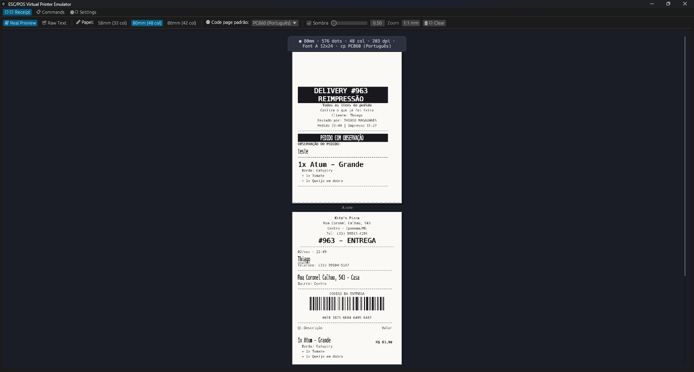
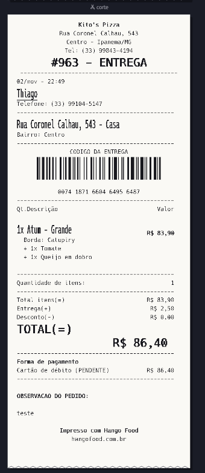
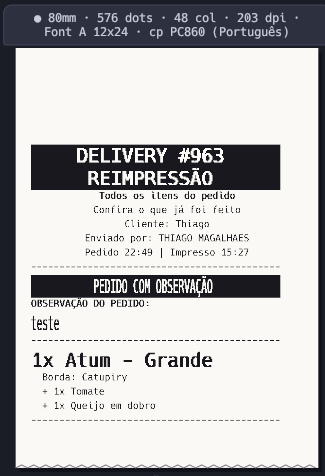
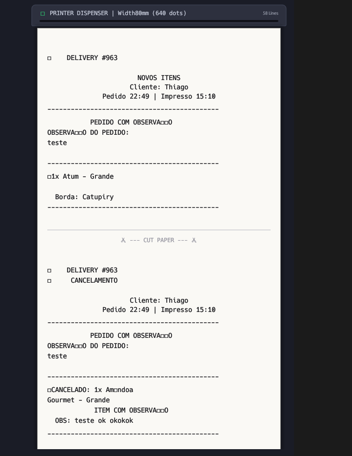

# 🖨️ Emulador de Impressora Térmica ESC/POS

[](https://www.rust-lang.org/)
[](LICENSE)


🇧🇷 **Português** | 🇺🇸 [English](README.en.md)

> Transforma o seu computador numa impressora térmica de cupom virtual.
> Ela mostra **exatamente** o que sairia no papel: mesma largura, colunas, tamanhos de letra, acentos, quebras de linha, QR codes e cortes.

Ideal para desenvolver e testar sistemas de PDV, delivery, comandas de cozinha e NFC-e sem gastar bobina e sem precisar de uma impressora física.



## ✨ Por que é fiel ao papel

O emulador não desenha "texto com uma fonte de tela". Ele funciona como o firmware da impressora: cada caractere é gravado **ponto a ponto** numa matriz de 203 dpi (8 pontos/mm), dentro da mesma célula que a impressora usa.

| | |
|---|---|
|  |  |
| Cupom de entrega com código de barras, colunas alinhadas e totais em tamanho duplo | Comanda com texto invertido (`GS B`), acentos via code page e tamanhos variados |

- **Fontes em matriz de pontos**: Font A 12×24 e Font B 9×17, iguais às impressoras compatíveis com Epson
- **Tamanhos reais**: `ESC !` e `GS !` (1× a 8× na largura e na altura), escalados como a impressora faz
- **Formatação**: negrito, sublinhado (1 ou 2 pontos), texto invertido, de cabeça para baixo e espaçamento entre caracteres
- **Layout**: quebra automática quando a linha enche, alinhamento por linha, espaçamento entre linhas (`ESC 2` / `ESC 3`), margens (`GS L` / `GS W`), posição absoluta e relativa, tabulação
- **Acentos corretos**: code pages `ESC t` PC437, PC850, PC860 (português), PC858 e WPC1252, com seletor de code page padrão
- **Imagens**: `GS v 0` (raster) e `ESC *` (bit image), usadas em logotipos
- **QR Code** (`GS ( k`) gerado de verdade, por exemplo para NFC-e
- **Código de barras** (`GS k`) com altura, largura e texto legível (HRI) corretos
- **Corte de papel** (`GS V`, `ESC i`, `ESC m`): cada cupom aparece separado, com borda de corte
- **Parser robusto**: cada comando consome exatamente os bytes certos, então nenhum parâmetro "vaza" como lixo no texto

### Antes × depois

Antes, o emulador ignorava `GS !` e a code page, e o resultado não batia com o papel. Os acentos viravam `□` e os tamanhos se perdiam:



## 📏 Larguras de papel

| Papel | Pontos imprimíveis (203 dpi) | Font A (12×24) | Font B (9×17) |
|-------|------------------------------|----------------|---------------|
| **58mm** | 384 | 32 colunas | 42 colunas |
| **80mm** | 576 | 48 colunas | 64 colunas |
| **80mm (42 col)** | 512 | 42 colunas | 56 colunas |

Ao trocar a largura do papel ou a code page padrão, tudo que já foi impresso é redesenhado.

## 🚀 Começando

### Pré-requisitos
- **Rust 1.70+**: [instalar Rust](https://rustup.rs/)
- **Windows 10/11** ou **Linux** com CUPS
- **Permissão de administrador**, só para instalar a impressora virtual

### Instalação

**Opção 1: baixar o executável (Windows).** Baixe o `.zip` na página de [Releases](https://github.com/thiagosmagalhaes/escpos-virtual-printer-emulator/releases/latest), extraia e rode `escpos_emulator.exe`. Não precisa instalar o Rust.

**Opção 2: compilar o código-fonte**

```bash
git clone https://github.com/thiagosmagalhaes/escpos-virtual-printer-emulator.git
cd escpos-virtual-printer-emulator
cargo run --release
```

### Uso

1. **Abra o emulador**: a interface sobe com o servidor TCP na porta **9100**
2. **Instale a impressora** (opcional): na aba **Settings**, clique em **"🖨️ Install Windows Printer"**. É usado o driver **Generic / Text Only** em modo RAW.
3. **Imprima**: pelo seu sistema, selecione `ESC_POS_Virtual_Printer` ou envie bytes ESC/POS para `127.0.0.1:9100`. A porta serial virtual também é suportada.
4. **Confira o resultado** na aba **Receipt**:
   - **Real Preview**: o papel renderizado ponto a ponto. Use o botão **1:1 mm** para ver em tamanho físico aproximado.
   - **Raw Text**: transcrição em texto, com régua de colunas
   - **Commands**: log de cada comando recebido

> 💡 **Os acentos saíram errados?** Escolha em **Code page padrão** a mesma code page configurada na sua impressora. A página de autoteste dela mostra qual é. Se o seu sistema envia `ESC t`, ele tem prioridade.

Teste rápido pelo PowerShell:

```powershell
$c = New-Object Net.Sockets.TcpClient('127.0.0.1', 9100)
$b = [byte[]](0x1B,0x40, 0x1B,0x61,1, 0x1D,0x21,0x11) + [Text.Encoding]::ASCII.GetBytes("TESTE`n") + [byte[]](0x1D,0x21,0, 0x1D,0x56,0)
$c.GetStream().Write($b, 0, $b.Length); $c.Close()
```

## 📋 Comandos ESC/POS suportados

| Comando | Descrição |
|---------|-----------|
| `ESC @` | Inicializa a impressora |
| `ESC !  n` | Modo de impressão (fonte, negrito, altura/largura dupla, sublinhado) |
| `GS !  n` | Tamanho do caractere (1–8× largura/altura) |
| `ESC M n` | Seleciona a fonte A/B |
| `ESC E n` / `ESC G n` | Negrito |
| `ESC - n` | Sublinhado (0/1/2 pontos) |
| `GS B n` | Texto invertido (branco no preto) |
| `ESC { n` | De cabeça para baixo |
| `ESC SP n` | Espaçamento à direita do caractere |
| `ESC a n` | Alinhamento (esquerda/centro/direita) |
| `ESC 2` / `ESC 3 n` | Espaçamento entre linhas |
| `ESC $` / `ESC \` | Posição horizontal absoluta / relativa |
| `ESC D` / `HT` | Paradas de tabulação / tabulação |
| `GS L` / `GS W` | Margem esquerda / largura da área de impressão |
| `ESC t n` | Code page |
| `LF`, `ESC J n`, `ESC d n` | Avanço de papel |
| `ESC *` / `GS v 0` | Imagens (bit image / raster) |
| `GS k`, `GS h`, `GS w`, `GS H` | Código de barras e configurações |
| `GS ( k` | QR Code |
| `GS V`, `ESC i`, `ESC m` | Corte de papel |
| `ESC p`, `DLE ...`, `FS ...`, `GS ( L` ... | Reconhecidos e ignorados (gaveta, status, kanji...) |

## ⚠️ Limitações conhecidas

- O desenho das letras usa uma fonte monoespaçada (Hack) rasterizada na mesma grade da impressora. **Largura, altura, colunas e quebras batem exatamente**, mas o traço de cada letra pode ser um pouco diferente da fonte da ROM do seu modelo.
- O código de barras sai com a altura e a largura certas, mas o padrão de barras é ilustrativo e não dá para ler com leitor.
- O modo página (`ESC L`) não é emulado.

## 🛠️ Desenvolvimento

```
src/
├── main.rs               # Ponto de entrada
├── lib.rs
├── escpos/
│   ├── commands.rs       # Definição dos comandos
│   ├── parser.rs         # Parser de fluxo ESC/POS (bytes → comandos)
│   ├── printer.rs        # Modelo da impressora: buffer de linha, quebra, página em pontos
│   ├── font.rs           # Gerador de caracteres em matriz de pontos
│   └── codepage.rs       # Tabelas de code page (ESC t)
├── emulator/mod.rs       # Estado do emulador e histórico
├── networking/
│   ├── server.rs         # Servidor TCP (porta 9100)
│   └── serial.rs         # Porta serial virtual
└── gui/
    ├── app.rs
    ├── receipt_viewer.rs # Visualização do papel
    ├── command_log.rs    # Log de comandos
    └── settings_panel.rs # Configurações e instalação da impressora
```

```bash
cargo build            # build de desenvolvimento
cargo build --release  # build otimizado
cargo test             # testes (parser, code pages, layout)
```

**Principais dependências:** `eframe/egui` (interface), `tokio` (rede), `ab_glyph` (rasterização da fonte), `qrcode` (QR Code) e `serialport`.

## 📄 Licença

MIT. Veja [LICENSE](LICENSE). Este projeto é baseado no *escpos-virtual-printer-emulator* original (ESC/POS Emulator Contributors).
